# Multi-site enterprise network

A two-site enterprise network built in Cisco Packet Tracer: a headquarters with two VLANs, an agency site, internet access through NAT, dynamic routing with OSPF, and basic security (ACL and SSH).

## Topology

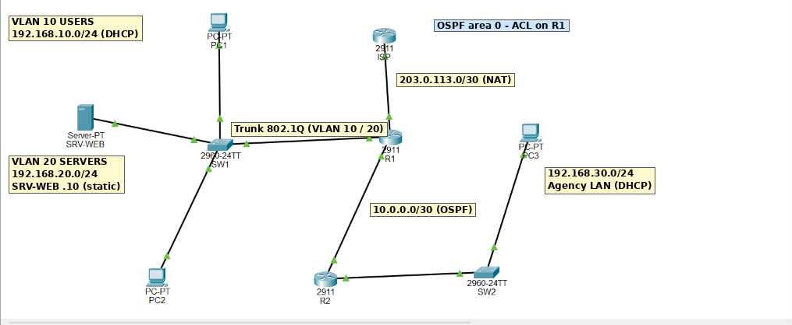

| Device | Role |
|--------|------|
| SW1 | Headquarters switch (VLAN 10 and 20, trunk to R1) |
| R1 | Headquarters router (inter-VLAN routing, DHCP, NAT, ACL, OSPF) |
| R2 | Agency router (DHCP, OSPF) |
| SW2 | Agency switch |
| ISP | Simulated internet provider (8.8.8.8 loopback) |
| SRV-WEB | Internal web server |

## Addressing plan

| Network | Subnet | Gateway | Notes |
|---------|--------|---------|-------|
| VLAN 10 USERS | 192.168.10.0/24 | 192.168.10.1 | DHCP from R1 |
| VLAN 20 SERVERS | 192.168.20.0/24 | 192.168.20.1 | SRV-WEB static 192.168.20.10 |
| Agency LAN | 192.168.30.0/24 | 192.168.30.1 | DHCP from R2 |
| R1 - R2 link | 10.0.0.0/30 | - | R1 .1, R2 .2 |
| R1 - ISP link | 203.0.113.0/30 | - | ISP .1, R1 .2 |

## Features

- **VLANs and inter-VLAN routing**: users (VLAN 10) and servers (VLAN 20) are separated on SW1 and routed by R1 (router-on-a-stick, 802.1Q trunk).
- **DHCP**: R1 serves VLAN 10 and R2 serves the agency LAN.
- **NAT overload**: all internal networks share R1's public address (203.0.113.2) to reach the internet.
- **OSPF (area 0)**: R1 and R2 exchange routes automatically. R1 also advertises the default route to the agency.
- **ACL**: users can only reach the web server (port 80) in VLAN 20; everything else towards the servers is denied.
- **SSH**: R1 and R2 are managed over SSH only (Telnet disabled).
- **Port security**: user ports on SW1 accept at most 2 MAC addresses (sticky).

## Design choices

- **Separate VLAN for servers**: isolates servers from users, so access can be filtered with an ACL.
- **OSPF instead of static routes**: the agency learns routes automatically, so adding a network does not require editing every router.
- **Passive interfaces**: OSPF is disabled towards the user VLANs, since no router is there to answer.
- **ACL placed on R1 g0/0.10 (inbound)**: traffic is filtered as close as possible to its source.
- **SSH rather than Telnet**: Telnet sends passwords in clear text.

## Tests and results

| # | Test | Command / action | Expected | Obtained |
|---|------|------------------|----------|----------|
| 1 | VLANs configured | `show vlan brief` on SW1 | VLAN 10 and 20 with their ports | OK |
| 2 | OSPF neighbor | `show ip ospf neighbor` on R1 | R2 in FULL state | OK |
| 3 | Routing table | `show ip route` on R1 | Agency route learned by OSPF, default route to ISP | OK |
| 4 | DHCP (HQ) | `ipconfig` on PC1 | Address in 192.168.10.0/24 | 192.168.10.12 |
| 5 | DHCP (agency) | `ipconfig` on PC3 | Address in 192.168.30.0/24 | 192.168.30.11 |
| 6 | HQ to agency | `ping` PC1 to PC3 | Replies | OK |
| 7 | Internet access (NAT) | `ping 8.8.8.8` from PC1 | Replies | OK |
| 8 | NAT translations | `show ip nat translations` on R1 | Private address translated to 203.0.113.2 | OK |
| 9 | Server reachable (before ACL) | `ping` PC1 to SRV-WEB | Replies | OK |
| 10 | ACL blocks ping | `ping` PC1 to SRV-WEB | Destination host unreachable | OK |
| 11 | ACL allows web | Browser on PC1 to http://192.168.20.10 | Page displayed | OK |
| 12 | ACL counters | `show access-lists` on R1 | Counters increase on permit and deny lines | OK |
| 13 | SSH to R1 | `ssh -l admin 192.168.10.1` from PC1 | Login prompt, then R1 CLI | OK |
| 14 | SSH to R2 via R1 | `ssh -l admin 10.0.0.2` from R1 | Login prompt, then R2 CLI | OK |

### Screenshots

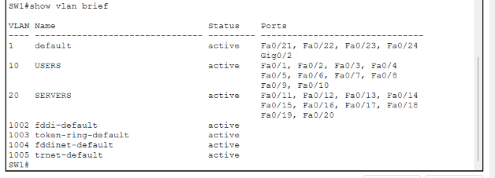
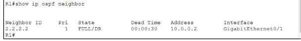
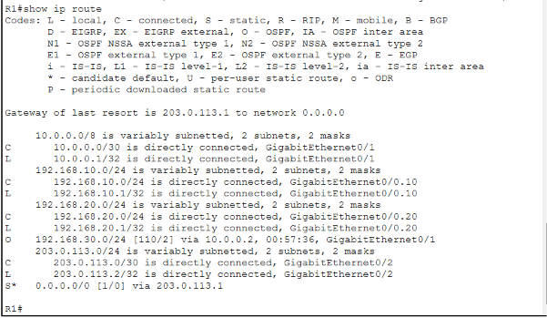
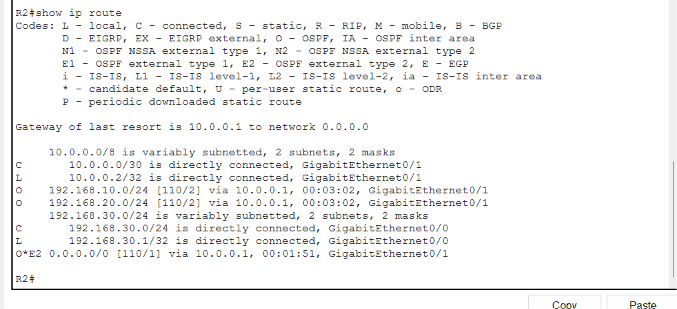
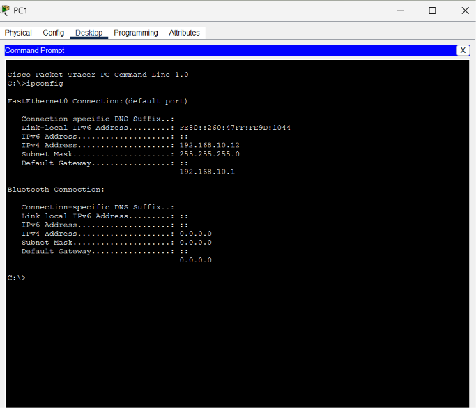
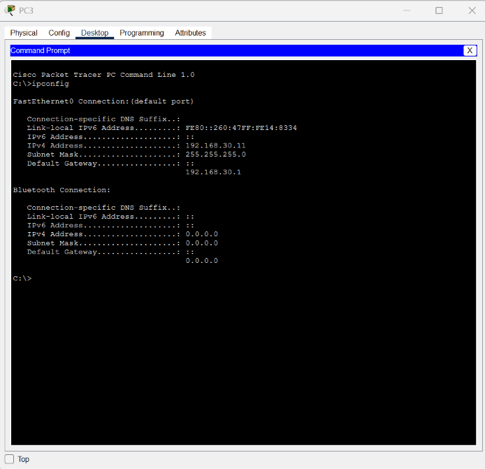
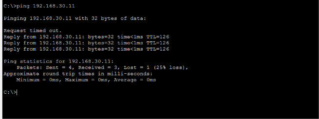
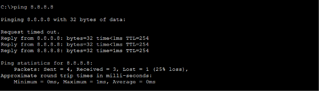
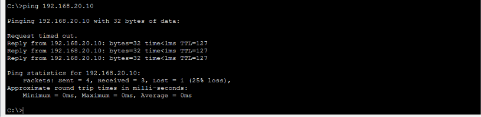
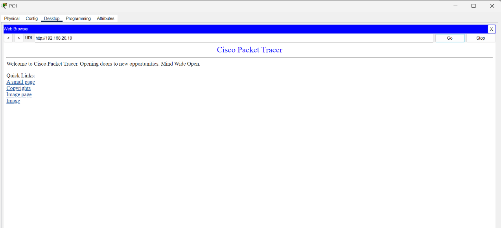
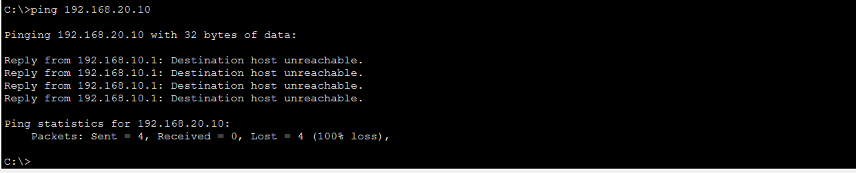
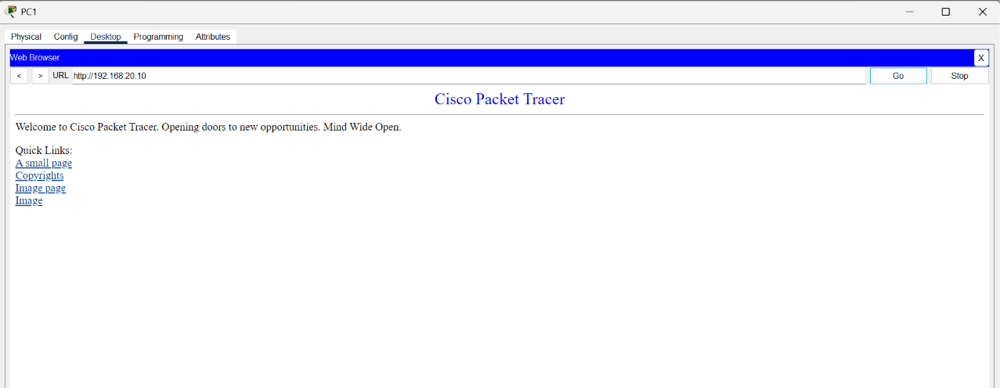
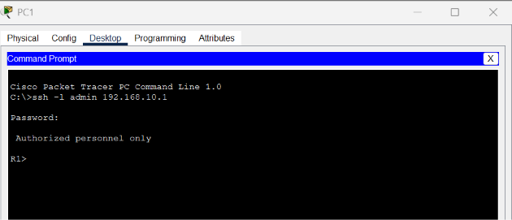
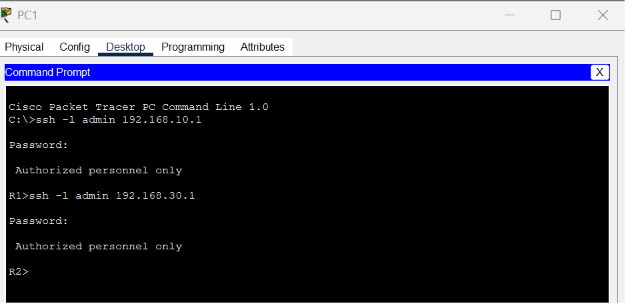
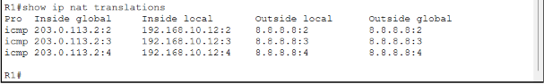
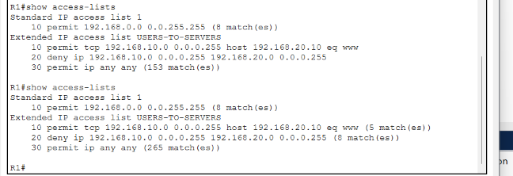

## Difficulties and lessons learned

- **Cabling and ports**: the first link between SW1 and R1 used a Fast Ethernet port, which cannot carry the trunk reliably. Moving it to GigabitEthernet0/1 fixed it. Packet Tracer's automatic cable does not let you choose the port, so I used a manual straight-through cable.
- **Static address for the server**: SRV-WEB had no address (0.0.0.0) and had to be configured by hand, since the ACL targets its fixed address.
- **Testing the ACL**: pinging the server from R1 worked even with the ACL in place. The ACL only filters traffic entering g0/0.10, so the test had to be done from PC1. The counters in `show access-lists` confirmed it.
- **SSH key generation**: `crypto key generate rsa modulus 2048` is not accepted in Packet Tracer. The interactive form works.

## Limits and possible improvements

- Passwords (`LabPassword1`, `LabPassword2`) are **lab-only** values. A real network would use unique passwords and a central authentication server.
- SW1 has no management IP, so it cannot be managed over SSH. Only R1 and R2 can.
- A single link connects each site: no redundancy. A second link and a routing protocol would remove this weak point.
- The ACL is deliberately simple. A real network would also filter traffic coming from the agency and the internet.

## Repository content

| Folder | Content |
|--------|---------|
| `packet-tracer/` | The Packet Tracer file (`multi-site-network.pkt`) |
| `configs/` | Running configuration of R1, R2, ISP and SW1 |
| `docs/img/` | Topology and test screenshots |

## How to reproduce

1. Install Cisco Packet Tracer.
2. Open `packet-tracer/multi-site-network.pkt`.
3. Open the CLI of each device and check the configuration (`show running-config`), or compare it with the files in `configs/`.

